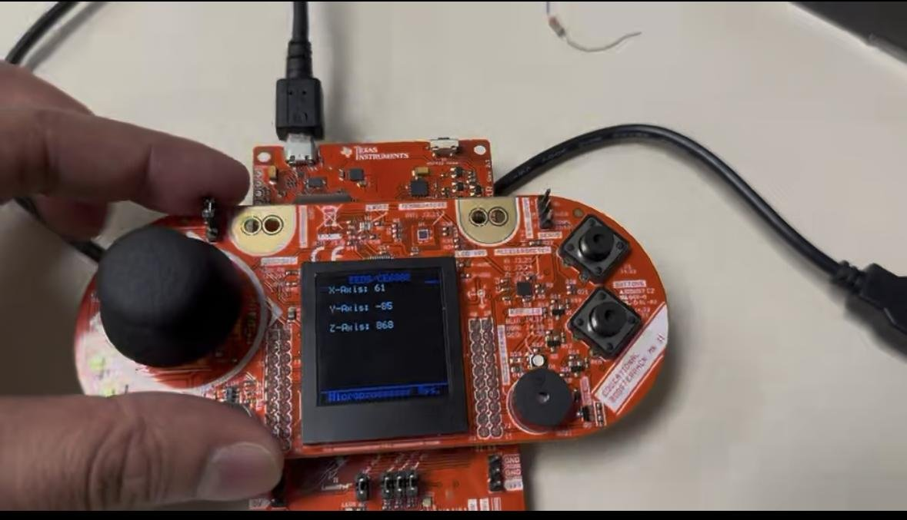
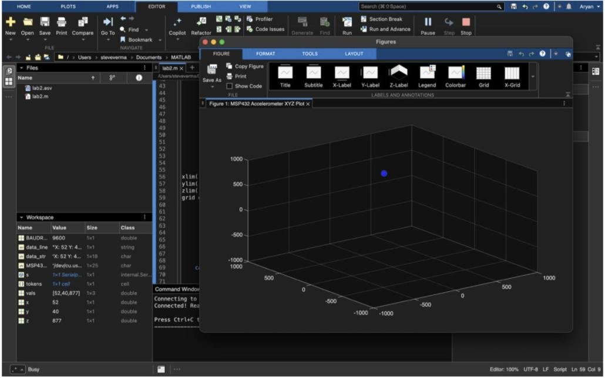

# 🧭 TiltScope — Real-Time 3D Motion Tracker (MSP432 + MATLAB)

> **See every tilt in real time: MEMS accelerometer to LCD to live MATLAB 3-D plot.**


Reads the **Kionix KXTC9-2050** analog MEMS accelerometer on the Educational BoosterPack MKII, shows X/Y/Z acceleration on the LCD, and streams the samples over serial to a **MATLAB** script that plots them live in 3-D.

<p align="center"> </p>

## Hardware & Software

- TI **MSP-EXP432P401R / MSP-EXP432P4111** LaunchPad
- TI **BOOSTXL-EDUMKII** (KXTC9-2050 accelerometer, HX8353E LCD)
- **Energia IDE**
- **MATLAB** (R2019b+ for `serialport`)

## Repository Structure

```
├── src/AccelerometerLCD/AccelerometerLCD.ino   # Energia sketch (LCD + serial)
├── matlab/accelerometer_3d_plot.m              # Real-time 3-D plot
└── images/
```

## How It Works

```
Accelerometer ──ADC (12-bit, pins 23/24/25)──► MSP432 ──► LCD  "X-Axis: …"
                                                  └──► UART 9600 "X: x Y: y Z: z" ──► MATLAB plot3()
```

- Each axis is read with `analogRead()` and the ~mid-scale offset (2024) is subtracted, so a level board reads ≈ 0 on X/Y and shows gravity on Z.
- Values are printed on the LCD and sent as `X: <x> Y: <y> Z: <z>` every 100 ms.
- The MATLAB script parses each line with a regular expression and redraws the point with `plot3()` inside fixed ±1000 axes.

## Build & Run

1. Mount the BoosterPack MKII on the LaunchPad.
2. Open `src/AccelerometerLCD/AccelerometerLCD.ino` in Energia, select **RED LaunchPad w/ msp432p401r EMT (48MHz)**, upload.
3. **Close the Energia Serial Monitor** (only one program can own the port).
4. Edit `MSP432_PORT` in `matlab/accelerometer_3d_plot.m` (e.g. `COM3`, `/dev/ttyACM0`, `/dev/cu.usbmodem…`) and run it.
5. Tilt the board; the LCD values and the 3-D point move in real time. Press **Ctrl+C** to stop.

## Concepts Covered

- Working principle of a capacitive 3-axis MEMS accelerometer and gravity-based tilt sensing
- ADC offset removal and scaling
- Serial data framing for external visualisation
- Real-time 3-D plotting in MATLAB (`serialport`, `readline`, `regexp`, `plot3`)

## Credits

LCD helper functions adapted from the MSP432 LCD framework by Qilin Si & Max Steele; based on Energia's `EducationalBP_MKII/AccelerometerSerial` example.

## Author

- **Aryan Verma**
